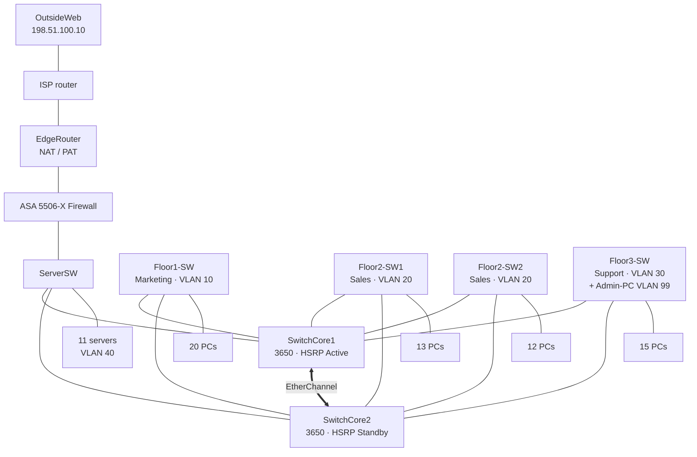

# MSS Ltd – Enterprise LAN Design (Cisco Packet Tracer)

A complete, working LAN design for **MSS Ltd**, a medium-sized company with three departments over three floors, built and tested in **Cisco Packet Tracer**. It was produced for the **CST4562** group coursework.

The design gives every department its own network, keeps running if a core switch or a link fails, and gives all staff the Internet, the company intranet, email and access to every department's database. It is protected by a firewall, NAT, access control lists, SSH-only management and port security.

---

## Contents

- [Scenario](#scenario)
- [Design at a glance](#design-at-a-glance)
- [Topology](#topology)
- [Devices used](#devices-used)
- [VLANs and IP addressing](#vlans-and-ip-addressing)
- [Servers and services](#servers-and-services)
- [Physical connections](#physical-connections)
- [Redundancy](#redundancy)
- [Internet edge](#internet-edge)
- [Security features](#security-features)
- [Verification tests](#verification-tests)
- [Packet Tracer limitations](#packet-tracer-limitations)
- [How to open the project](#how-to-open-the-project)
- [Future improvements](#future-improvements)
- [Team](#team)

---

## Scenario

| Department | Floor | Workstations |
|---|---|---|
| Marketing | 1 | 20 |
| Sales | 2 | 25 |
| General Support | 3 | 15 |

Requirements from the brief:
- Everyone needs access to the **Internet**, the company **intranet** and **email**.
- Each department has its **own database**, and **all staff can access every database**.
- **Departmental application servers**, a **backup database server** and a **backup/archive server** are required.
- A **redundancy plan** in case of system failure.
- **Security and maintenance** must be considered.

---

## Design at a glance

| Area | Choice |
|---|---|
| Architecture | Two-tier hierarchical, also called a collapsed core: access switches connect to a redundant pair of core multilayer switches |
| Segmentation | One VLAN per department, plus server and management VLANs |
| Routing between VLANs | On the core switches (SVIs) |
| Gateway redundancy | HSRP: both cores share a virtual gateway |
| Core link | EtherChannel (LACP), two links bundled into one |
| Loop prevention | Spanning tree, with SwitchCore1 as root |
| Addressing | DHCP from a central server, relayed by the cores |
| Name resolution | Internal DNS server |
| Internet | Core → ASA firewall → edge router (NAT/PAT) → ISP |
| Management | Separate VLAN 99, SSH v2 only, blocked from user VLANs by ACL |

---

## Topology



**Physical layout:** the server room and core switches sit on **Floor 2**, the middle floor, so cable runs to Floors 1 and 3 are equal and short. Each floor has a wiring cupboard holding its access switch(es), linked to the server room by the riser.

---

## Devices used

| Role | Packet Tracer model | Qty | Name(s) |
|---|---|---|---|
| Core / distribution | Cisco **3650-24PS** multilayer switch | 2 | SwitchCore1, SwitchCore2 |
| Floor access switches | Cisco **2960-24TT** | 4 | Floor1-SW, Floor2-SW1, Floor2-SW2, Floor3-SW |
| Server access switch | Cisco **2960-24TT** | 1 | ServerSW |
| Firewall | Cisco **ASA 5506-X** | 1 | Firewall |
| Edge router | Cisco **2911** | 1 | EdgeRouter |
| ISP (simulated) | Cisco **2911** | 1 | ISP |
| Servers | Server-PT | 11 + 1 | See [Servers](#servers-and-services), plus OutsideWeb |
| Workstations | PC-PT | 60 + 1 | Market-PC1–20, Sales-PC1–25, Support-PC1–15, Admin-PC |

**Why two switches on Floor 2:** Sales has 25 PCs, more than the 24 user ports on a 2960. Splitting across two switches also means one switch failure only affects half the department.

---

## VLANs and IP addressing

| VLAN | Name | Subnet | Gateway (HSRP virtual IP) | SwitchCore1 | SwitchCore2 | DHCP range |
|---|---|---|---|---|---|---|
| 10 | Marketing | 192.168.10.0/24 | 192.168.10.1 | .2 | .3 | .100 – .199 |
| 20 | Sales | 192.168.20.0/24 | 192.168.20.1 | .2 | .3 | .100 – .199 |
| 30 | Support | 192.168.30.0/24 | 192.168.30.1 | .2 | .3 | .100 – .199 |
| 40 | Servers | 192.168.40.0/24 | 192.168.40.1 | .2 | .3 | Static only |
| 99 | Management | 192.168.99.0/24 | 192.168.99.1 | .2 | .3 | Static only |

Each department gets a /24 (254 addresses), leaving plenty of room for growth.

### Management addresses (VLAN 99)

| Device | IP |
|---|---|
| Floor1-SW | 192.168.99.11 |
| Floor2-SW1 | 192.168.99.12 |
| Floor2-SW2 | 192.168.99.13 |
| Floor3-SW | 192.168.99.14 |
| ServerSW | 192.168.99.15 |
| Admin-PC | 192.168.99.50 |

### Edge and Internet addressing

| Link | Addresses |
|---|---|
| Firewall inside (Gig1/2) | 192.168.40.254 /24 |
| Firewall outside (Gig1/1) ↔ EdgeRouter (Gig0/0) | 10.0.0.1 ↔ 10.0.0.2 /30 |
| EdgeRouter (Gig0/1) ↔ ISP (Gig0/0) | 203.0.113.2 ↔ 203.0.113.1 /30 |
| ISP (Gig0/1) ↔ OutsideWeb | 198.51.100.1 ↔ 198.51.100.10 /24 |

The outside addresses come from the ranges set aside for documentation (RFC 5737), so they're safe to use in a lab model.

---

## Servers and services

All servers are in **VLAN 40** with static addresses, gateway 192.168.40.1 and DNS 192.168.40.10.

| Server | IP | ServerSW port | Purpose |
|---|---|---|---|
| DHCP-DNS | 192.168.40.10 | Fa0/1 | DHCP pools for VLANs 10/20/30; internal DNS |
| Email | 192.168.40.11 | Fa0/2 | SMTP + POP3, mail domain `mss.com` |
| Intranet | 192.168.40.12 | Fa0/3 | Company intranet (HTTP) |
| DB-Marketing | 192.168.40.21 | Fa0/4 | Marketing database |
| DB-Sales | 192.168.40.22 | Fa0/5 | Sales database |
| DB-Support | 192.168.40.23 | Fa0/6 | Support database |
| DB-Backup | 192.168.40.24 | Fa0/7 | Backup copy of all department databases |
| Backup-Archive | 192.168.40.25 | Fa0/8 | Backups and long-term archive |
| App-Marketing | 192.168.40.31 | Fa0/9 | Marketing applications |
| App-Sales | 192.168.40.32 | Fa0/10 | Sales applications |
| App-Support | 192.168.40.33 | Fa0/11 | Support applications |

### DNS records

| Name | Address |
|---|---|
| `intranet.mss.local` | 192.168.40.12 |
| `mail.mss.local` | 192.168.40.11 |

### DHCP

- One pool per department VLAN, each handing out the correct gateway and DNS server.
- The core switches relay requests to the server with `ip helper-address 192.168.40.10`.

### Email

- Mail domain: `mss.com`. Packet Tracer's email client rejects `.local` addresses, so the internal device domain `mss.local` is kept separate from the mail domain.
- User accounts exist for each group member.

---

## Physical connections

### Core uplink ports

| Core port (on both cores) | Connected to |
|---|---|
| Gig1/0/1 | ServerSW |
| Gig1/0/2 | Floor1-SW |
| Gig1/0/3 | Floor2-SW1 |
| Gig1/0/4 | Floor3-SW |
| Gig1/0/5 | Floor2-SW2 |
| Gig1/0/23 – 24 | Port-channel 1 (EtherChannel to the other core) |

Every access switch uses **Gig0/1 to SwitchCore1** and **Gig0/2 to SwitchCore2**. The one exception is Floor2-SW2, whose two uplinks are swapped; this was confirmed with `show cdp neighbors`.

### Cabling (real-world design)

| Link | Medium |
|---|---|
| Desk to floor switch | Cat6 copper (under 90 m) |
| Floor switch to core (riser) | Multimode fibre, ready for 10 Gbps |
| Core to core | 2 × Gigabit in an EtherChannel |

In the Packet Tracer model, copper Gigabit links stand in for the fibre risers.

### Capacity

| Switch | Ports used | Spare |
|---|---|---|
| Floor1-SW | 20 | 4 |
| Floor2-SW1 | 13 | 11 |
| Floor2-SW2 | 12 | 12 |
| Floor3-SW | 15 + Admin-PC | 8 |

Each access port gets its own 100 Mbps; each floor shares a 1 Gbps uplink (about 2:1 oversubscription, comfortable for office traffic).

---

## Redundancy

| Failure | What keeps the network running |
|---|---|
| One core switch fails | **HSRP:** SwitchCore2 takes over the .1 gateway for every VLAN |
| One floor uplink fails | **Spanning tree:** the blocked backup uplink to the other core starts forwarding |
| One core-to-core cable fails | **EtherChannel:** the second cable carries on |
| A database server fails | **DB-Backup** holds a copy of every department database |
| Data loss | **Backup-Archive** server for scheduled backups |

SwitchCore1 is both the **HSRP active router** and the **spanning-tree root** for all VLANs, so traffic takes the same path at layer 2 and layer 3. SwitchCore2 is the standby for both.

---

## Internet edge

```
PC → floor switch → core → ServerSW → Firewall → EdgeRouter → ISP → Internet
```

- **Core switches:** default route `0.0.0.0/0 → 192.168.40.254` (the firewall).
- **Firewall (ASA):**
  - `inside` interface, security level 100, faces the company.
  - `outside` interface, security level 0, faces the Internet.
  - Routes to every internal network via the core gateway.
- **EdgeRouter:**
  - **PAT (NAT overload):** every internal address shares the single outside address 203.0.113.2.
  - Default route to the ISP, plus a route back to 192.168.0.0/16 via the firewall.
- **ISP + OutsideWeb:** simulate an Internet provider and a public website for testing.

---

## Security features

| Feature | Where | What it does |
|---|---|---|
| VLAN segmentation | All switches | Keeps each department in its own broadcast domain |
| Management VLAN 99 | All switches | Device management is kept apart from user traffic |
| ACL `DEPT-IN` | Core SVIs for VLANs 10/20/30 | Blocks every department from reaching the management network; all other traffic is allowed |
| SSH v2 only | All access switches | Encrypted remote login; Telnet disabled (`transport input ssh`) |
| Local accounts + enable secret | All access switches | Login needs a username and password; privileged mode needs a secret |
| Port security | Floor switch ports Fa0/1–23 | Max 2 MAC addresses per port, sticky learning, violations dropped and logged (`restrict`) |
| Firewall | Internet edge | Inside/outside zones; outside access list allows only reply traffic (web replies, ping replies) back in |
| NAT/PAT | EdgeRouter | Hides all internal addresses behind one public address |
| Unused interfaces shut down | Firewall, VLAN 1 | Reduces the attack surface |
| No DHCP on server/management VLANs | Design | Infrastructure addresses are set by hand only |

> Lab credentials used in the model are for demonstration only and are not listed here.

---

## Verification tests

| Test | Method | Result |
|---|---|---|
| EtherChannel | `show etherchannel summary` | Po1(SU), both ports (P) |
| HSRP | `show standby brief` | SwitchCore1 Active, SwitchCore2 Standby for all 5 VLANs |
| Trunks / STP | `show interfaces trunk` on each access switch | Both uplinks trunking; one forwarding, one backup |
| DHCP | PCs set to DHCP | Each PC gets an address in its department range |
| Inter-VLAN routing | Ping Sales ↔ Marketing ↔ servers | 0% loss |
| Same VLAN across switches | Sales-PC1 ↔ Sales-PC25 | Replies |
| DNS + intranet | Browser to `http://intranet.mss.local` | Intranet page loads |
| Email | Nash (Marketing) → Allen (Sales) | Message received; DNS resolves `mail.mss.local` |
| Internet + NAT | Browser to `http://198.51.100.10`; `show ip nat translations` | Page loads; translations to 203.0.113.2 shown |
| SSH management | `ssh -l admin 192.168.99.11` from Admin-PC | Login successful; wrong password rejected |
| Management lockdown | Ping 192.168.99.11 from Market-PC1 | "Destination host unreachable" from the core (blocked by ACL) |
| Port security | `show port-security` | All user ports secured, action Restrict |

---

## Packet Tracer limitations

- **No ASA failover:** the `failover` command is not supported on Packet Tracer's ASA (tested: "Unrecognized command"). A real deployment would use an **active/standby ASA pair**; it is included in the design but could not be simulated.
- **Return traffic through the ASA:** Packet Tracer's ASA did not pass web replies back on its own, so an outside access list was added that permits **reply traffic only** (from ports 80/443, and ping replies).
- **Port counts:** the 2960 model only comes in a 24-port version. A real build might use 48-port switches.
- **Fibre risers:** modelled as copper Gigabit links.

---

## How to open the project

1. Install **Cisco Packet Tracer 8.x** (free through Cisco Networking Academy).
2. Open the `.pkt` file from this repository.
3. Click any PC, go to **Desktop**, and use the **Command Prompt**, **Web Browser** or **Email** apps to try out the network.
4. Click any switch or router and use the **CLI** tab to inspect its configuration, for example `show running-config`, `show vlan brief` or `show standby brief`.

---

## Future improvements

- **Active/standby firewall pair** and a **second ISP link** to remove the remaining single points of failure.
- **Wireless access**: one access point per floor, using WPA2/WPA3-Enterprise.
- **DMZ** for any public-facing servers.
- **10 Gbps fibre uplinks**, or EtherChannel on the floor uplinks, as traffic grows.
- **Voice VLAN** for IP phones.
- **Central logging (Syslog), NTP time sync and RADIUS/AAA** login for the network devices.
- **Offsite or cloud backup** to protect against loss of the whole site.
- **IPv6** dual-stack addressing.

---

## Team

CST4562 group coursework:

- Nash
- Allen
- Ashrith
- Mohammed
- Randy
